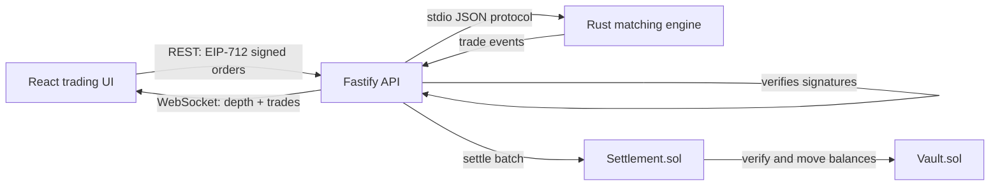

# OpenBook

[](https://github.com/SachuJames/openbook-dex/actions/workflows/ci.yml)
[](LICENSE)

A decentralized exchange with a central limit order book: off-chain matching in Rust, on-chain settlement in Solidity.

## How it works



Traders sign orders off-chain (EIP-712). A Rust engine matches them under
price-time priority. A Settlement contract re-verifies every signature,
nonce, expiry, and balance on-chain before moving funds in the Vault. The
operator can order trades but can never steal funds.

## Highlights

- Central limit order book in Rust: limit, market, cancel, and amend orders,
  deterministic price-time priority matching, self-trade prevention.
- Integer-only money math everywhere (no floats in matching or settlement).
- EIP-712 signed orders, verified twice: once by the API, once on-chain.
- Batch on-chain settlement with full revert coverage (bad signature, replay,
  expiry, insufficient balance, price outside limits).
- Live trading UI: order book depth, recent trades, and order placement with
  in-browser signing, fed by WebSocket.
- End-to-end local demo: mint, deposit, trade, settle on-chain, verify
  balances. See `demo.sh`.

## Benchmarks

Matching engine throughput, release build, 200k orders per phase:

| Operation | Throughput |
|---|---|
| Limit order insert | ~970,000 orders/sec |
| Order matching | ~743,000 orders/sec (200,000 trades) |

Measured with `cargo run --release --bin bench` on the development VM.
Your numbers will vary by machine.

Test coverage: 22 Rust tests (matching edge cases, determinism, protocol),
15 Hardhat contract tests (settlement success and every revert case),
28 API tests (EIP-712 round trips, engine integration, WebSocket feed).

## Quickstart

Prerequisites: Rust (stable), Node 20+, npm.

```bash
# 1. Build the matching engine
cargo build --release

# 2. Install contract and app dependencies
(cd contracts && npm install)
(cd apps/api && npm install)
(cd apps/web && npm install)

# 3. Run the full end-to-end demo (local chain, deploy, trade, settle)
./demo.sh
```

The demo starts a local Hardhat chain, deploys the Vault, Settlement, and
test tokens, launches the API, places signed orders from two traders, matches
a trade off-chain, settles it on-chain, and prints vault balances before and
after. It exits 0 on success.

Manual run:

```bash
# terminal 1: local chain
(cd contracts && npx hardhat node)

# terminal 2: deploy (note the printed addresses)
(cd contracts && npx hardhat run scripts/deploy.js --network localhost)

# terminal 3: API (point it at the deployment)
(cd apps/api && RPC_URL=http://127.0.0.1:8545 SETTLEMENT_ADDRESS=<addr> \
  VAULT_ADDRESS=<addr> BTC_ADDRESS=<addr> USDC_ADDRESS=<addr> \
  SETTLER_KEY=<hardhat-account-0-key> npm run dev)

# terminal 4: UI
(cd apps/web && npm run dev)
```

## Tech stack

- Matching engine: Rust (serde, serde_json), stdio JSON protocol
- Contracts: Solidity 0.8.24, Hardhat, OpenZeppelin (ERC-20, EIP-712, ECDSA)
- API: TypeScript, Fastify, @fastify/websocket, ethers v6
- UI: React, Vite, TypeScript, ethers v6
- CI: GitHub Actions (Rust tests/clippy/fmt, Hardhat tests, API tests, UI build)

## Scope and limitations

Honest notes on what this is and is not:

- This is a working prototype, not audited production code. Do not use it
  with real funds.
- Matching is run by a single operator. Ordering fairness and liveness depend
  on the operator; only custody and settlement validity are trustless. See
  `docs/ARCHITECTURE.md` for the full trust model.
- The demo runs on a local Hardhat chain with test tokens. Nothing here has
  touched a public network.
- Nonce tracking in the API is in-memory; a restart forgets it (the contract
  still enforces nonces on-chain).
- Dockerfiles are provided for reference but the Docker daemon was not
  available in this build environment, so images were not built or run here.
- One market (BTC/USDC) is wired through the demo; the engine itself
  supports multiple symbols.

## Layout

```text
crates/matching-engine   Rust order book and matching engine
contracts                Vault, Settlement, test tokens (Solidity + Hardhat)
apps/api                 Order intake, EIP-712 verification, WS feed, settlement
apps/web                 Trading UI (React)
docs                     Architecture notes and this protocol spec
demo.sh                  End-to-end local demo
```
